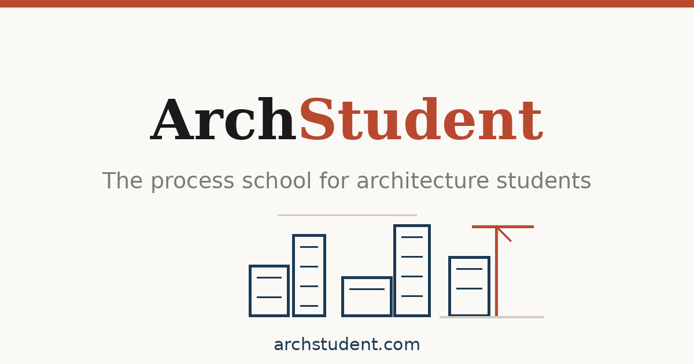

<h1 align="center">ArchStudent</h1>

<i>The process school for architecture students.</i>

  
  

## About

ArchStudent is a content platform I designed and built for architecture students worldwide. It combines a global schools directory, an encyclopedia of famous architecture and architects, and a moderated community wall — all built on a custom PHP stack with a strong focus on technical SEO and automated media pipelines.

## Key features

- **World schools directory** — 260+ architecture schools across 70+ countries, with campus photos auto-fetched and cached from Wikimedia Commons
- **Famous architecture** — per-country pages of notable buildings with verified imagery and structured data
- **Architects encyclopedia** — profiles across many countries with portraits and their built work
- **Moderated community wall** — students post feedback; entries stay private until approved via a private moderation dashboard
- **Automated media pipeline** — a scheduled job keeps imagery fresh without manual work
- **Engineered for SEO** — clean URLs, JSON-LD, sitemaps and fast, cache-friendly pages

## Built with

    

## About this repository

This is a **case study** of a production project I designed, built and maintain. The application is live at **[archstudent.com](https://archstudent.com/)**. The source code is proprietary and kept private — this page documents the work and the engineering behind it.

---

Built by <b><a href="https://jeemmo.com/">Azeem Javed (Jeemmo)</a></b> · <a href="https://www.linkedin.com/in/azeem-javed-7666861a/">LinkedIn</a> · Jeemmo is the trading name of Verivello Ltd, a UK-registered company.
